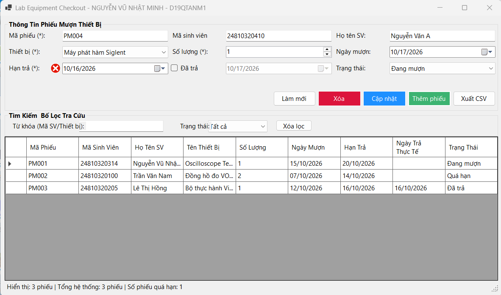
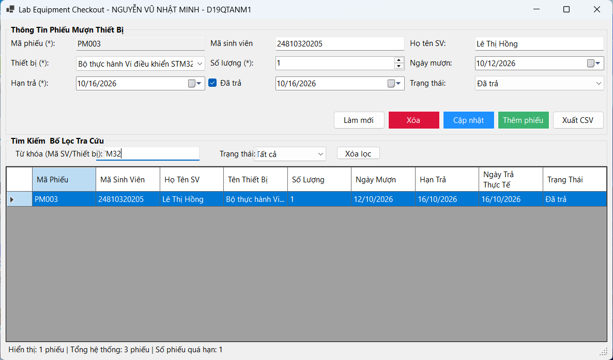
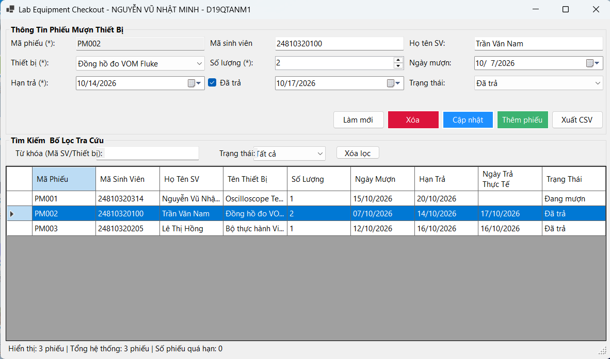

# BÁO CÁO BÀI TẬP / ĐỒ ÁN

## THÔNG TIN SINH VIÊN
- **Họ và tên:** HOÀNG GIA HƯNG
- **Mã số sinh viên:** 24810320102
- **Lớp:** D19QTANM1
- **Tên môn học:** Lập trình C# / Windows Forms
- **Tên bài tập:** BÀI 4.10: Quản lý mượn trả thiết bị tại phòng thực hành (Lab Equipment Checkout)

---

## KẾT QUẢ THỰC HÀNH & KIỂM THỬ

### 1. Không cho nhập hạn trả trước ngày mượn

### 2. Tìm kiếm theo mã sinh viên hoặc tên thiết bị trả về đúng kết quả

### 3. Trạng thái và số lượng trên bảng/thanh trạng thái cập nhật trước khi sửa, xóa và lọc

### 4. Trạng thái và số lượng trên bảng/thanh trạng thái cập nhật sau khi sửa, xóa và lọc

---
